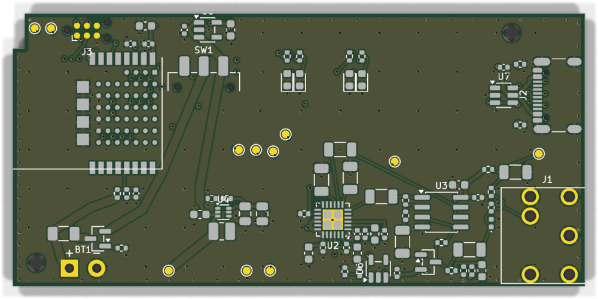
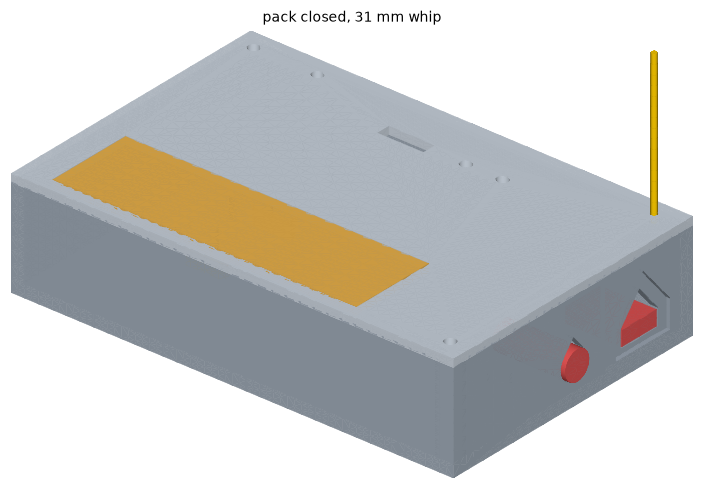
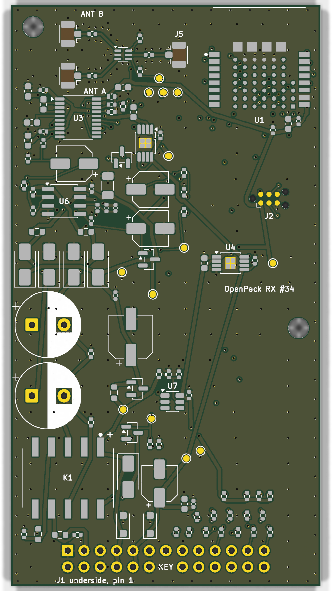
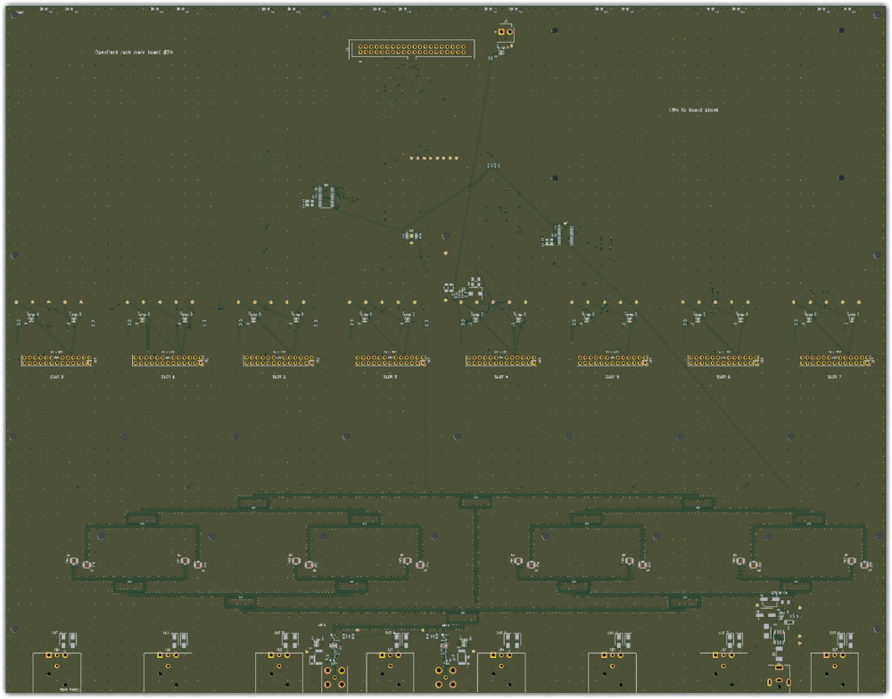

# OpenPack: a wireless microphone system for UK theatre

**Final design report, written in the style of an IB Design Technology Internal Assessment**

Date: 1 November 2026. Repository: `saturncity/openpack`, at `main` 72fe649 (PR #125 merged).

---

## How this report differs from a real IA

A real IB DT IA ends with a working prototype that was built, tested by hand and photographed. **Nothing in this project has been physically built yet.** You decided that nothing would be bought until the whole design was finished (ADR-0019), so every "prototype" and every "test" in this report is virtual:

| Virtual prototype or test | What it stands in for |
|---|---|
| **BabbleSim (bsim)** radio simulation running the real firmware for the pack and receiver, with modelled Wi-Fi interference | A radio test in a busy theatre |
| **Twister and unit tests** (Zephyr's firmware test runner, plus 20 Python test files) | Bench tests of the firmware |
| **G2 and G3 CI gates** (automatic checks run on every change on GitHub) | The "does it still work?" checks after every change |
| **ngspice** circuit simulation | Measuring noise and clipping with a scope and analyser |
| **KiCad DRC** (design rule check) on all three circuit boards | Checking that a board can be made |
| **CadQuery fit checks** (3D models of the enclosures) | Test-fitting parts in a printed case |
| **`audit.py`** (a script that recalculates every key number from the design files) | A lab notebook of calculations |

So this report says "passes in simulation" or "passes by calculation", never "passes". The real tests are planned and listed in section D (issues #37–#42 and #92), and they run after one shopping trip (section C9).

Every number in this report comes from the repository: `REQUIREMENTS.md`, `SPEC.md`, `docs/design-log.md`, the ADRs in `docs/adr/`, `STATUS.md`, `hw/REVIEW.md`, `docs/shopping-list.md` and the output of `python3 audit.py`.

---

## A. Analysis of the design opportunity

### A1. The problem

In a theatre, every actor with a speaking or singing part wears a small radio transmitter (a **bodypack**) clipped to the body under the costume. A thin cable runs from it to a tiny microphone in the hair or on a headset. Backstage, a **receiver rack** picks up all the packs and sends each actor's voice down its own cable (an XLR lead) to the sound desk.

Professional systems from Sennheiser, Shure and others work very well but cost a lot per channel. You wanted to find out whether a small theatre could have an eight-channel system of near-professional quality, with packs costing about $30 each in parts. The design also had to cope with the hardest condition in modern theatre: **an audience of several hundred people whose phones are all using Wi-Fi and hotspots on the same 2.4 GHz radio band**.

### A2. The client's needs

Your requirements are in `REQUIREMENTS.md`, ranked so that the higher one wins when two clash. In short:

| Rank | Requirement (your words) | How it is measured |
|---|---|---|
| R1 | "Must survive heavy 2.4 GHz audience Wi-Fi and pocket hotspot interference" | ≤ 0.1 % frames lost per hour, ≤ 2 lost in a row, ≤ 1 audible dropout (ADR-0003) |
| R2 | "No vocal clipping when actors scream or whisper" | No clipping at 0.6 Vrms input (about 134 dB SPL) |
| R3 | "Sub-3ms latency" | ≤ 3 ms target, 5 ms hard limit, microphone to XLR |
| R4 | "Absolutely no physical mute buttons, volume knobs, or user controls" | Inspection |
| R5 | "Match top-tier Sennheiser packs" | ViSQOL audio score ≥ 4.0; noise ≤ 1 µV |
| R6 | Standard locking theatre mics, including DPA | Sennheiser pinout, locking 3.5 mm jack |
| R7 | Removable 18650 battery, quick crew swaps | Swap in < 30 s without tools |
| R8 | "16 to 20 hours of continuous runtime" | Calculated, then measured |
| R9 | 8 packs, 1U rack, one XLR per channel | Inspection |
| R10 | Two antennas on the rack, not 8–16; cope with body blocking | 2 antenna sockets |
| R11 | Control from the booth over Ethernet (REST/WebSocket) | API tests |
| R12 | "Roughly $30 per beltpack" | Parts ≤ $35 at 100 units, without the cell |
| R13 | "Test everything in simulation before building a 4-pack prototype" | Phase gates in `PLAN.md` |
| R14 | Basic status LEDs | Battery and peak/clip LEDs |
| R15 | 3D-printed case, flexible wire whip antenna | Inspection |

You also ruled some things out: no screen on the pack, no Dante, no other radio bands (sub-1 GHz or 5 GHz), and no gain control on the pack.

### A3. Research

**Existing systems.** Commercial digital systems give each pack its own radio channel (one or more carriers per pack, called FDMA). That pattern was adopted here (design log RF-1). The repository holds no measured figures or prices for competing products, and the question of which Sennheiser model "Sennheiser quality" means (EW-D, G4 or another) was never answered (QUESTIONS.md Q5). So the quality target became a measurable stand-in: a ViSQOL score of at least 4.0 against the original 24-bit recording. An early audit (AUDIT-2.md) warned honestly that a $30 pack using 6-bit audio compression gives "good speech, not EW-D" quality.

**Why one shared radio channel cannot work.** The first idea was to send all eight packs on one channel, taking turns. `audit.py` shows that eight packs using the LC3plus codec need **155 %** of the available airtime, which is impossible. LC3plus also adds about 6 ms of delay against a 3 ms target. A simpler codec, ADPCM at 6 bits per sample, fits in **52 %** of one channel for one pack sending two copies. So each pack gets its own pair of carriers.

**Not enough clean space between Wi-Fi channels.** Wi-Fi in the UK mostly uses channels 1, 6 and 11. Eight packs with two copies each need 16 carriers, but only **7 to 10** fit in the gaps between Wi-Fi channels (`audit.py` Audit 2). So some copies have to sit under Wi-Fi, and the design must survive that.

**Wi-Fi losses come in bursts.** A burst model (Gilbert-Elliott) in `audit.py` shows that even with only 10 % of the airtime busy, the losses arrive as about **105 audible events per minute** if nothing is done about them. This is why the design sends every frame twice on carriers at least 40 MHz apart, and why "time diversity" was studied (section B).

**UK radio rules.** You are in the UK, so the rules are Ofcom's **IR 2030** (interface IR2030/7/1: 100 mW EIRP and 10 mW/MHz in 2400–2483.5 MHz) under the Radio Equipment Regulations 2017, and the European standard **ETSI EN 300 328 V2.2.2** (ADR-0015). The key findings were:

- Any transmitter at **10 dBm EIRP or more** must either listen before talking or leave a silent gap of at least 3.5 ms. OpenPack sends every millisecond, and its longest gap is 436 µs, so it must stay **below 10 dBm**.
- The power-density limit alone caps this kind of signal at 11.2 dBm.
- So the pack is declared at **9 dBm EIRP** (+7 dBm from the module plus a 2 dBi whip antenna). That is 1 dB under the line.
- US rules (FCC 15.247) would allow 20 dBm, which is 11 dB more. The hardware supports both, and the firmware enforces the UK limit (design log FW-10).

This was the biggest single finding of the project. In simulation, at UK power, only **2 of 8 packs** met the dropout target with heavy Wi-Fi (ADR-0015). The shortfall was **12.7 dB** of isolation (design log RF-5). Because the UK rules limit only the transmitter, the answer had to come from the receiving side (section B3).

### A4. Design brief

Design an eight-channel digital wireless microphone system for UK theatres. It has a body-worn pack with no user controls, a removable 18650 cell and a printed case, and a 1U receiver rack with eight XLR outputs, two antennas and an Ethernet control API. It must meet UK radio rules at 9 dBm EIRP, survive a full house of audience Wi-Fi, stay under 3 ms of delay, and cost about $30 per pack in parts. The whole design must be checked digitally before anything is bought.

### A5. Specification (from SPEC.md)

| ID | Specification | Verified by |
|---|---|---|
| SYS-1 | 8 packs → 1 rack, 1U, 8 balanced analogue outputs | Inspection |
| SYS-2 | Latency ≤ 3.0 ms target, ≤ 5.0 ms limit. Design: **2.67 ms** (2.28 ms with the DAC low-latency filter) | bsim + logic analyser |
| SYS-3 | 1 h under interference: ≤ 0.1 % loss, ≤ 2 frames in a row, ≤ 1 audible event | bsim, then bench |
| SYS-4 | 48 kHz, 20 Hz–20 kHz ±0.5 dB, ViSQOL ≥ 4.0 | ViSQOL |
| SYS-5 | 2.4 GHz only; UK 9 dBm EIRP, EN 300 328 non-adaptive | `audit.py`, then measurement |
| AIR-4 | 1 ms frames, two copies on two carriers | Firmware tests |
| AIR-5 | 16 carriers, all ≥ 3 MHz apart; one Wi-Fi-gap carrier per pack | Channel-plan validator |
| PK-2 | 0.6 Vrms without clipping; noise ≤ 1 µV A-weighted | ngspice |
| PK-7 | ≥ 16 h runtime | `audit.py`, then PPK2 |
| PK-8 | Recessed power switch only; battery and peak/clip LEDs | Inspection |
| PK-11 | Case ≤ 100 × 65 × 25 mm, PETG, printed clip, tool-free battery door | CadQuery |
| PK-12 | Parts ≤ $35 at 100 units, without the cell | `audit.py` |
| RX-7 | Receiver clock tracks the pack: no buffer slips in 1 h at ±40 ppm | bsim |
| RK-1 | 1U, 12 V brick, 8 XLR, 2 BNC, RJ45, USB-C | Inspection |
| RK-5 | Rack noise figure ≤ 21.1 dB; no stage overloads | `audit.py` Audit 6 |
| API-1/2 | REST API plus WebSocket telemetry at 10 Hz | Schemathesis, pytest |

---

## B. Conceptual design

### B1. How options were judged

Every major decision is recorded as an **Architecture Decision Record (ADR)**: 22 in total. Each later ADR has a **requirements check table**, which scores every option against R1–R15 with ✓, partial or ✗. The higher-ranked requirement wins. This is the project's equivalent of an IA evaluation matrix, and the main ones are summarised below.

### B2. Radio concept: one carrier pair per pack

| Option | Result | Source |
|---|---|---|
| One shared channel, packs take turns (TDMA) | ✗ 155 % airtime with LC3plus; 6 ms codec delay | `audit.py`, AUDIT.md |
| 5 GHz on an ESP32-C5 | ✗ Wi-Fi-style access cannot guarantee timing; pack power 0.24 → 0.59 W; you shelved 5 GHz | design log RF-1 |
| Sub-1 GHz (902–928 MHz) | ✗ US-only band; you shelved it | research digest, REQUIREMENTS |
| **One carrier pair per pack (FDMA), ADPCM-6, each 1 ms frame sent twice** | ✓ chosen | RF-1, ADR-0002 |

**Codec (ADR-0005).** Three codecs were compared on 21 clips (speech, singing including belt, and a whisper-to-scream sweep):

| Codec | ViSQOL mean / worst at 0 dB | at −20 dB |
|---|---|---|
| ADPCM-6 (chosen) | 4.60 / 4.20 | 4.61 / 4.29 |
| ADPCM-8 | 4.62 / 4.34 | 4.65 / 4.46 |
| Block-float 8+3 | 4.62 / 4.27 | 4.65 / 4.50 |

The best possible score (16-bit) is 4.73. All three passed the 4.0 bar on every clip. ADPCM-6 was chosen because only its 39-byte frame leaves room for the time-diversity copy inside the 85-byte packet. This decision now has a loose end (open risk 13, section D3).

**Chip (ADR-0007).** The Nordic nRF5340 was chosen because it has two cores, an adjustable audio clock and a free simulator (BabbleSim). On its own it reaches only +3 dBm, so the pack uses the **Fanstel BT40NE** module, which adds an nRF21540 amplifier and a u.FL antenna socket. A pre-certified module avoids designing the radio circuitry from scratch.

### B3. Surviving a full house under UK power (ADR-0015, 0016, 0021)

ADR-0015 tested six options for the UK. Only option F, which runs at US power, met R1, and that is illegal in the UK:

| R-id | A: 9 dBm, amplifier kept | B: listen-before-talk | C: frequency hopping | D: no amplifier | E: 1 Mbit mode | F: US power |
|---|---|---|---|---|---|---|
| R1 | ✗ 2/8 pass | ✗ | ✗ | ✗ | ✗ | ✓ |
| R3 | ✓ | ✗ | ✗ | ✓ | partial | ✓ |
| Legal | ✓ | ✓ | ✓ | ✓ | ✓ | ✗ |

This was a "stop and ask" for you. You chose to fix the problem at the receiver: **directional panel antennas (L-com HG2409P-NF, 8 dBi) with an installation rule**, which ADR-0016 records. ADR-0016 also gave pack 1 a final gap carrier at **2482 MHz**, legal in the UK and EU but not in the US. You then said the antennas could go **only in the wings**, so ADR-0021 compared five layouts:

| R-id | **A: 4 m boom, aimed at far upstage corner, BT40E receivers** | B: mid-wing at 2 m | C: A + 10 dB pad | D: A + switched pad | E: omni antennas |
|---|---|---|---|---|---|
| R1 | ✓ worst point ≥ 1.5 dB over threshold | ✗ up to 8.2 dB under | ✓ | partial | ✗ 2.6–7.5 dB under |
| R12 | ✓ $58 less per rack | ✓ | partial | partial | ✓ |
| R13 | ✓ | ✓ | ✓ | partial | ✓ |

**Chosen (A).** One antenna per wing, **4.0 m up** (never below 3.5 m), 1 m offstage, a quarter of the stage depth back, aimed at the far upstage corner and tilted 10° down. There must be no Wi-Fi in the wings, backstage Wi-Fi at least 6 m away, and crew phones in airplane mode. In simulation, all 7 packs that the simulator can run met the dropout target in all 12 test cases. The tightest case lost **0.086 %** of frames against the 0.1 % limit.

### B4. Time diversity off by default (ADR-0017)

Time diversity (TD) means each packet also carries a copy of the frame from two packets earlier, so a short burst of interference can be repaired. It costs 2.3 ms of extra delay. Once every pack had a gap carrier and the antennas protected it, TD made no difference: packs 2–8 lost **0.000 %** with TD on or off. So:

| R-id | **A: off by default, on per pack (chosen)** | B: always on | C: never |
|---|---|---|---|
| R1 | ✓ | ✓ | partial (no fallback) |
| R3 | ✓ 2.65 ms | partial (4.58 ms) | ✓ |

Packs set to TD on are 2.3 ms later than the others. That is still within R3, but the sound designer needs to know.

### B5. Other concept decisions

- **One-way link (ADR-0004).** Packs only transmit and the rack only listens. A 300 µs listening slot is reserved for a future version. This keeps the pack simple and cheap.
- **Front end (ADR-0006).** There is one fixed-gain path (×2) into a PCM1840 converter with dynamic range enhancement, rather than two gain paths stitched together. R2 ✓ and R5 ✓ (0.94 µV noise at the time).
- **Mechanical (ADR-0008).** Everything is printed in PETG on your Bambu A1 mini (180 mm bed): case body 96 × 62 × 22.8 mm, a separate belt clip on M2 heat-set inserts, and a snap-arm battery door.
- **One purchase (ADR-0019).** All digital work comes first, then one shopping list. The cost is that the boards are designed before any bench calibration, so a board re-spin (a second, corrected run of boards) is possible.

---

## C. Detailed design

### C1. System overview

```mermaid
flowchart LR
  subgraph Pack["Bodypack x8 (BT40NE)"]
    MIC[Lav / headset mic<br/>locking 3.5 mm] --> PRE[OPA1656 preamp x2]
    PRE --> ADC[PCM1840 ADC<br/>48 kHz]
    ADC --> ENC[nRF5340 app core<br/>ADPCM-6, 1 ms frames]
    ENC --> RAD[net core radio<br/>copy A + copy B]
    RAD --> FEM[nRF21540 FEM<br/>+7 dBm] --> WHIP[31 mm whip<br/>9 dBm EIRP]
    BAT[18650 cell] --> PWR[boost 5 V / LDO 3.3 V]
  end
  WHIP -. 2.4 GHz .-> ANT
  subgraph Rack["1U rack"]
    ANT[2x HG2409P-NF panels<br/>in the wings, 4 m up] --> COAX[CA-400 coax] --> LNA[QPL9057 LNA] --> BAW[QPQ1907 filter] --> WIL[1:8 Wilkinson]
    WIL --> RX[8x receiver sub-board<br/>BT40E]
    RX --> DAC[PCM5102A DAC] --> DRV[balanced driver] --> XLR[8x XLR out]
    RX -- UART --> HOST[Raspberry Pi CM4<br/>REST / WebSocket]
    HOST --> ETH[etherCON to booth]
  end
```

### C2. The bodypack



*Pack board, 73.4 × 35.0 mm, 4 layers (kicad-cli render; the parts are drawn as pads because no 3D part models are installed). Top-down copper view: [img/pack-top.png](img/pack-top.png).*



*CadQuery model of the closed pack with the 31 mm whip.*

Key features (ADR-0012, design log PK-1 to PK-14):

- **Microphone input.** A Same Sky SJ1-3543 locking 3.5 mm jack, wired to Sennheiser's pinout from the ew 100 G4 manual (tip = mic +, ring and sleeve = ground). DPA capsules connect through a DAD6034 adapter. The mic gets 5 V bias through 2.2 kΩ.
- **Preamp.** An OPA1656 at a fixed ×2 (330 Ω / 330 Ω) feeds a PCM1840 ADC. Simulated noise is **0.967 µV** against the 1 µV limit. That is a 3 % margin, which shrank from 6 % when a 100 Ω protection resistor was added for hot-plugging.
- **Radio.** The Fanstel BT40NE module (nRF5340 + nRF21540). The UK power ceiling of +7 dBm is checked when the firmware is built. The whip is a 31 mm wire soldered to a u.FL pigtail, 40.9 mm from the cell.
- **Controls and LEDs.** One recessed slide switch. Green battery, red low-battery, amber peak and red clip LEDs. The clip LED lights at −7 dBFS because the single-ended ADC input clips near −6.3 dBFS. There is no "link" LED, because a one-way pack cannot know whether it is being received.
- **Configuration.** A recessed USB-C port used only for setup, not charging.
- **Layout.** Four layers, laid out by a script through KiCad's API (no autorouter was available). DRC: **0 errors, 0 unconnected** (hw/REVIEW.md). An image review of the rendered layers found and fixed faults that DRC missed, including a 28 mm audio loop round the jack (now 4.9 mm) and two shorted capacitors (design log TS-15).

### C3. The receiver sub-board



*Receiver sub-board, 48 × 90 mm, 4 layers. Top copper: [img/rx-top.png](img/rx-top.png).*

Eight of these plug into the rack board (ADR-0014, design log RX-1 to RX-14):

- A **BT40E** module (no amplifier; see C4) with an antenna switch.
- A PCM5102A DAC strapped to its low-latency filter (FLT=1). This saves 385 µs.
- A single-supply balanced driver to the XLR, at **+17.98 dBu** for full-scale digital, with 1.4 dB of headroom and an output impedance of 88 Ω.
- A mute relay and a supply supervisor, to stop a thump reaching the PA if the power fails.
- **Keyed connector.** A 2 × 13 header with pin 14 removed. Plugged in the wrong way round, +12 V would land on the radio's reset pin, so the board has no hole at position 14.
- DRC **0 errors, 0 warnings, 0 unconnected**, with JLCPCB's rules proven to load. An earlier bug meant KiCad had silently ignored the whole rules file (design log TS-8).

### C4. The rack



*Rack main board, 412.0 × 321.5 mm, 4 layers. The eight receiver slots are across the middle and the two splitter trees and rear connectors are at the bottom. Top copper: [img/rack-top.png](img/rack-top.png).*

The signal path for each antenna (ADR-0018, design log RK-1 to RK-7k):

**BNC → ESD protection → switchable 12 V bias-T → QPL9057 low-noise amplifier → QPQ1907 band filter → 3-stage Wilkinson 1:8 splitter → 8 receivers.**

- **Why BT40E receivers.** A pack 0.5 m from a panel would overload the BT40NE's always-on amplifier by 15 dB (design log RF-9). The BT40E has no amplifier, so nothing overloads. Every stage stays at least 6 dB under its overload point, and it saves $58 per rack.
- **Noise figure.** **12.86 dB** worst case at the 6 dB coax budget, against a need of 21.1 dB, which leaves **8.2 dB** of margin (`audit.py` Audit 6).
- **The splitter loses more than planned.** As drawn, it loses **13.66 dB** against the original 11 dB target, because the ports are spread across 400 mm. The limit was changed to ≤ 14 dB in PR #126 (design log RK-7c).
- **Host.** A Raspberry Pi CM4 (no wireless) on its official IO board, with 8 UARTs, Ethernet via an etherCON socket, and a 12 V brick.
- **Fit.** The Hammond RM1U1913SBK aluminium 1U case. CadQuery check: **3.39 mm** clearance under the lid and 2.35 mm to the front panel. 106 box checks pass. DRC: 0 errors, 0 unconnected.

### C5. Firmware

One Zephyr application, built as either pack or receiver (SPEC FW-1):

- **Pack.** The radio core sends copy A, waits 100 µs, then sends copy B on the second carrier, once every millisecond. The application core encodes ADPCM-6. Its timing follows the audio clock, which a PI control loop holds **100 ± 3 µs** ahead of the radio (ADR-0020, ADR-0022). This fixed a bug where one frame was skipped every 40 minutes (design log FW-2, FW-4).
- **Receiver.** It locks on within 2 s and takes the first valid copy. Packet-loss concealment (PLC) repeats the last frame with a fade, then mutes after 10 ms. The receiver chooses between its two antennas per carrier, with a new rule to switch on a missed packet (ADR-0021). A clock-recovery loop keeps the DAC in step with the pack: in a 1-hour simulation at ±40 ppm there were **0 slips** and the error stayed ≤ 0.28 samples (ADR-0013).
- **Boards.** Pin assignments are generated from the circuit netlists and checked in CI (PR #119). The bootloader is MCUboot with ECDSA-P256 signing (PR #121). It still uses the public development key.
- **In progress.** Issue #25 (real receiver telemetry, saved settings, USB console, firmware update command) is being finished in PR #129 and has **not merged**. Until it does, pack settings are lost at power-off (design log FW-11).

### C6. Latency

From SPEC §2 and `audit.py` (µs):

| Stage | TD off | TD on |
|---|---:|---:|
| ADC filter (PCM1840 low-latency) | 160 | 160 |
| Collecting 48 samples | 1000 | 1000 |
| Encode, hand-over, latch | 120 | 120 |
| Transmitter ramp-up | 41 | 41 |
| Copy A on air | 212 | 368 |
| Retune gap | 100 | 100 |
| Copy B on air | 212 | 368 |
| Decode + jitter slot | 200 | 200 |
| DAC buffer | 167 | 167 |
| DAC filter (normal) | 458 | 458 |
| Time diversity | 0 | 2000 |
| **Total** | **2670** | **4982** |
| **With DAC FLT=1 (as built)** | **2285** | **4597** |

The radio section measured in bsim is **884 µs** (1196 µs with TD), inside the G2 gate of 1.6 ms. One finding: the original budget was missing a 435 µs wait before transmission, so the true figure was about 3.1 ms. Moving the latch fixed it (design log FW-3).

### C7. Power and battery

- **Supply chain.** One protected 18650 in a printed cradle, a reverse-polarity P-FET, a 3 A fuse (a PTC fuse would have wasted 0.2 V), a TPS61023 boost to 5 V and two 3.3 V regulators. There is no charger in the pack.
- **Cutoff.** The firmware switches off after 5 s below **3.3 V** under load. That figure is the ADC's 3.0 V minimum plus regulator dropout, wiring losses and measurement error (`audit.py`).
- **Runtime.** **17.5 h** at 0.55 W, using 85 % of the cell. That meets the 16 h requirement with 1.5 h to spare (design log PW-2).
- **Rack protection.** A fused, reverse-protected 12 V input, with a separate electronic fuse for each slot so that one faulty receiver trips only itself (design log PW-5).

### C8. Mechanical

- **Pack.** A PETG case of 96 × 62 × 22.8 mm, within the ≤ 100 × 65 × 25 mm spec. The board is raised 1.4 mm so the antenna clears the clip bosses. It has light pipes, a printed switch fork and a tool-free battery door. The CadQuery fit test runs in CI.
- **Rack.** The receivers sit 30.1 mm above the main board, with 4.9 mm spare under the lid line (design log ME-3).
- **Open question.** The Hammond case's side screw lugs may touch the rack board's edges. The drawing does not settle it. If a dry fit shows contact, the edges can be notched (open risk 18).

### C9. Components, UK sourcing and cost

**Pack parts cost (`audit.py`, qty 100, without the cell).** The parts come to **$33.34** against the $35 cap (PK-12). That is **$3.34 over** your ~$30 target. The module accounts for $13.47 of it, at Fanstel's direct price. At Digi-Key's price the parts come to **$36.63**, which is over the cap. PCB assembly ($3–6) and conformal coating are not included. At the repo's exchange rate of 1.31, $33.34 is about £25.

**Rack cost (`audit.py`, ex VAT).** **£1,501.50** (£1,801.80 inc VAT). That is made up of the main board, host and cables £709.04, eight receivers £187.04, antennas, coax and adapters £294.86, and two stands with mast kits £310.56. Like for like without stands it is £1,190.94, against the brief's £800–830. The Hammond case (£140.76) and the CM4 (£79.20) were your choices. The board order is an estimated £300 (design log RK-7k).

**The single shopping list (PR #125, `docs/shopping-list.md`).** It covers 4 packs, 4 receivers, the rack and bench tools. It is grouped by UK supplier: 15 baskets, including Digi-Key UK, Farnell UK, RS UK, LCSC, JLCPCB, ITM Components, Rapid and The Pi Hut. The list's totals are checked by `tests/test_shopping.py`, which passes (8 tests):

| | Ex VAT | Inc VAT |
|---|---:|---:|
| **Required total** | **£2,376.79** | **£2,852.15** |
| of which quoted from a supplier page | £1,642.56 | |
| of which estimated (no page read) | £734.23 | |
| Optional cuts you may take (still inside the total) | £428.41 | £514.09 |
| Total after all cuts | £1,948.38 | £2,338.06 |

The cuts are: the two Thor stands plus delivery, if the venue's own booms can be used (£311.66), the PPK2 power meter (£80.17), and the second nRF5340 development kit (£36.58). The largest estimate is the rack PCB order (£300).

Sourcing points:

- The tinySA spectrum analyser has no UK stockist, so it comes from Lab401 in France.
- No page selling protected 18650 cells could be read, so they are an estimate.
- Both Fanstel modules have a lead time of about 10 weeks, so order them first.
- LCSC and JLCPCB orders are split to stay under £135 each, so import VAT is paid at checkout and there is no duty.

---

## D. Testing and evaluation

### D1. Results against the specification

| Req. | Test method (virtual) | Result | Status |
|---|---|---|---|
| R1 / SYS-3 | bsim scenario (c): 3 venue geometries, 10 % and 40 % Wi-Fi, TD on and off, 12 cases | 7/7 runnable packs pass every case; worst **0.086 %** ≤ 0.1 % (TD off). Pack 1 (2482 MHz) passes only by equivalence | **Pass in sim**; pending bench G5/G6 (#39, #42) |
| R2 / PK-2 | ngspice transient at 0.6 Vrms | No clipping (ADR-0006) | **Pass in sim**; real DPA at scream level pending |
| R3 / SYS-2 | `audit.py` budget + bsim (a) radio timing | **2.67 ms** (2.28 ms with FLT=1); TD on 4.60 ms | **Pass by calc + sim**; logic analyser pending (#38) |
| R4 / PK-8 | Design inspection | Only a recessed slide switch | **Pass (design)** |
| R5 / SYS-4 | ViSQOL on 21 clips; ngspice noise | Worst **4.20** ≥ 4.0; noise **0.967 µV** ≤ 1 µV (3 % margin) | **Pass in sim**; FLT=1 ViSQOL and bench noise pending |
| R6 / PK-1 | Pinout from the Sennheiser manual | Pinout correct on paper | **Pass (design)**; physical lock fit pending |
| R7 / PK-6 | CadQuery fit test, design | Tool-free door, printed cradle | **Pass (design)**; < 30 s swap pending first print |
| R8 / PK-7 | `audit.py` runtime model | **17.5 h** ≥ 16 h | **Pass by calc**; PPK2 measurement pending |
| R9 / SYS-1 | CadQuery rack fit (106 checks) | 1U, 8 XLR, 3.39 mm under the lid | **Pass in CAD**; side-lug dry fit pending |
| R10 | Design; body loss budgeted at 10 dB + 10 dB fade | 2 BNC on the rack | **Pass (design)**; body blocking pending (Phase 5/6) |
| R11 / API | Schemathesis + pytest in CI (G3), receiver reset test | Passing on `main` | **Pass in CI**; real receiver telemetry in PR #129, in progress |
| R12 / PK-12 | `audit.py` BOM | **$33.34** ≤ $35 at Fanstel price; $36.63 at Digi-Key | **Partial**: cap met, ~$30 target missed by $3.34 |
| R13 | `PLAN.md` gates G1–G4 | All design done digitally first | **Pass** |
| R14 | Design | 4 LEDs (battery, low, peak, clip) | **Pass (design)** |
| R15 | CadQuery | Printed PETG case, 31 mm whip | **Pass (design)**; first print pending |
| RX-7 | bsim, 1 h at ±40 ppm | 0 slips, ≤ 0.28 samples | **Pass in sim**; real crystals pending |
| FW-7 | bsim, 1 h at +0.371 / ±40 ppm | 0 skipped frames, lead 100 ± 1 µs | **Pass in sim** |
| SYS-5 | Build-time power check; clause analysis | 9 dBm EIRP; 2482 MHz edge 2483.28 MHz | **Pass on paper**; spectrum check pending (#92) |
| RK-5 | `audit.py` Audit 6 | NF 12.86 dB ≤ 21.1 dB | **Pass by calc**; VNA pending |
| G4 | KiCad DRC, image review, fit | 0 DRC errors on all 3 boards | **Pass**, except the fab DFM check, still to do |

CI on `main` (72fe649): the `ci` and `fw` workflows pass.

### D2. Strengths

- **Every decision is traceable.** 22 ADRs with requirement scores, a design log of over 100 entries, and `audit.py` recalculating the key numbers.
- **The firmware ran in simulation before any hardware existed.** It runs in the radio simulator, with automatic gates on latency, loss, locking and clock drift.
- **Independent reviews caught real faults** that design checks had passed (design log PR-3). These included a filter wired with no RF path, a resistor that would have burned out, and a reversible connector that would have put 12 V on a radio pin.
- **Latency is comfortably within target** (2.28 ms as built), even after hidden delays were found and added.

### D3. Weaknesses and open risks

These are the main items from the design log's "Open risks for audit" table, which has 18 in total:

| # | Risk | Closes when |
|---|---|---|
| 1 | **Thin dropout margin**: 0.086 % against 0.1 %, and it only holds if the wing install rule is followed | G5 bench + G6 full house |
| 2 | **Pack 1's 2482 MHz carrier was never simulated** (the simulator stops at 2480). It fails EN 300 328 if its occupied bandwidth exceeds 2.51 MHz | #92 spectrum check |
| 3 | Boards designed before bench calibration; a **re-spin is possible** | Phase 5 agrees with the twin |
| 4 | Two amplifier pin settings on the pack (ANT_SEL level, MODE pin) are best guesses | Bench check or Fanstel answer |
| 5 | Module certification paperwork incomplete (whip not on the FCC grant; no UK/EU declaration from Fanstel) | Fanstel test reports; own declaration |
| 7 | TD-on latency only **23 µs** under the 4.6 ms spec line | Logic analyser |
| 8 | Preamp noise margin only 3 % | Bench noise measurement |
| 11 | Firmware signed with the public development key | Private key before units leave the bench |
| 12 | Rack splitter loss is modelled, not measured | VNA |
| 13 | ADPCM-6 vs ADPCM-8 not re-decided after TD went off by default | ADR-0005 amended, maybe a listening test |
| 14 | Pack BOM is over $35 at Digi-Key prices; 10-week module lead | Purchase quote |
| 15 | The simulator has no body loss, fading or overload, and its runs are 20–60 s rather than 1 h | G5 within 20 % of the twin |
| 16 | No fab DFM run yet | DFM reports at order time |
| 17 | Rack £1,501.50 against an £800–830 target | Your decision on cuts |
| 18 | Case side lugs may touch the rack board | Dry fit |

The others are 6 (antenna rear lobes read off a plot), 9 (phone leakage near the gap carriers) and 10 (band-edge filter loss).

### D4. Planned bench tests (after the single purchase)

| Issue | Test |
|---|---|
| #37 | Set up the bench (`docs/human/bench-setup.md`) |
| #38 | Dev-kit bring-up: ADC/DAC delay, lock, end-to-end latency, conducted power, current → feed the twin |
| #39 | Bench interference test → gate G5 |
| #40 | Receive bare PCBs + stencil |
| #41 | Assemble and plug in (`docs/human/assembly.md`) |
| #42 | 4-pack hostile-RF test, then a real full house → gate G6 |
| #92 | Mount the antennas per the rule, measure the rear lobes and the 2482 MHz spectrum |

### D5. Improvements

1. **Settle the codec question.** Amend ADR-0005: either ADPCM-6 everywhere, or ADPCM-8 on packs without TD after a listening test.
2. **Get Fanstel's EN 300 328 reports** and confirm the two pin settings before ordering.
3. **Cut the rack cost.** Use venue booms instead of the stands (−£311.66), and get a real JLC quote to replace the £300 estimate.
4. **For a v2:** a smarter loss concealment if the measured audible-event rate exceeds 10 per hour (ADR-0010); a downlink using the reserved 300 µs slot; and sub-1 GHz as the strongest fallback if UK Wi-Fi proves worse than modelled.
5. **Merge #25 (PR #129)** so settings survive power-off.

---

## E. Commercial production

**4 units versus 100.**

- **The 4-unit prototype** is a hand-assembled build. It uses bare boards and a stencil from JLCPCB, 10 boards of each design (4 plus 6 spares in case of a re-spin), and parts bought by the basket at single-unit prices.
- **At 100 units** the pack parts cost $33.34 each, with the module priced at Fanstel's 100-unit break. Fanstel's 1,000-unit price ($12.24) would add margin.
- **Assembly at 100.** The packs would go to JLC assembly. The rotation tables and LCSC part numbers for this are already generated. The BT40NE module would be sent to JLC separately because LCSC does not stock it, and its underside pads need an X-ray inspection.
- **Before volume production:**
  - run DFM on all three boards;
  - fix the remaining JLC rotation mappings;
  - choose one LCSC code for the u.FL;
  - order the 10-week modules and the 20-week rack eFuse early;
  - replace the printed clip if PETG fatigue shows on the bench. Printing does not scale well beyond small batches.

**Manufacturability.**

- All boards are 4-layer, 1.6 mm FR-4, built to JLCPCB's standard rules, and every part sits on one side.
- The pack fits a 180 mm printer bed.
- The rack is one large board (412 × 321.5 mm). That is the most expensive item in the rack and the most likely to change.

**Certification route (UK).**

- OpenPack would make its **own UK Declaration of Conformity** under the Radio Equipment Regulations 2017, covering:
  - EN 300 328 V2.2.2 at 9 dBm EIRP;
  - EN 301 489-1/-17 (radio interference);
  - EN 62368-1 (electrical safety);
  - EN 62479 (RF exposure: 7.9 mW is under the 20 mW exemption).
- Fanstel publishes no UKCA or EU declaration for either module, so their test reports must be obtained. If those reports do not cover this configuration, the product would need its own lab tests.
- A US version would need a Class II permissive change to the module's FCC grant and an RF exposure evaluation, because the whip antenna is not on that grant.
- Selling and certification are outside v1 and need a decision from you before they go ahead (SPEC §10).

---

## Appendix

**ADRs** (`docs/adr/`):

- [0001 latency vs time diversity](../adr/0001-latency-vs-time-diversity.md) (superseded by 0017)
- [0002 eight packs and Wi-Fi overlap](../adr/0002-eight-packs-wifi-overlap.md)
- [0003 pass numbers](../adr/0003-pass-numbers.md)
- [0004 one-way link](../adr/0004-one-way-link-v1.md)
- [0005 codec](../adr/0005-codec.md)
- [0006 front end](../adr/0006-front-end.md)
- [0007 SoC module](../adr/0007-soc-module.md)
- [0008 clip and panel](../adr/0008-clip-and-panel.md)
- [0009 packet layout](../adr/0009-air2-ble-pdu-layout.md)
- [0010 event-rate gate](../adr/0010-event-rate-gate.md)
- [0011 receiver tracking](../adr/0011-rx-tracking-and-antenna-probe.md)
- [0012 pack pinouts](../adr/0012-pack-schematic-pinouts.md)
- [0013 receiver clock loop](../adr/0013-rx-jitter-slot-and-clock-loop.md)
- [0014 receiver connector](../adr/0014-rx-backplane-connector.md)
- [0015 region UK](../adr/0015-region-uk.md)
- [0016 rack antennas and 2482](../adr/0016-uk-r1-rack-antennas-and-2482.md)
- [0017 TD off by default](../adr/0017-time-diversity-off-by-default.md)
- [0018 rack RF and host](../adr/0018-rack-backplane-rf-and-host.md)
- [0019 single purchase](../adr/0019-single-consolidated-purchase.md)
- [0020 frame clock](../adr/0020-pack-frame-clock-phased-to-latch.md)
- [0021 wing antennas](../adr/0021-wing-antenna-install-rule.md)
- [0022 frame lead loop](../adr/0022-pack-frame-lead-loop.md)

**Key merged PRs:**

- #55 codec bake-off
- #66 bsim calibration
- #75 pack schematic
- #77 receiver clock recovery
- #81 receiver schematic
- #82 G2 scenarios
- #86 UK region
- #93 rack antennas / TD off
- #95 rack backplane
- #96 G3 host tests
- #103 wing antennas
- #104 pack layout
- #111 latch timing
- #114 frame lead loop
- #116 receiver layout
- #119 board targets
- #121 MCUboot signing
- #123 design log
- #125 shopping list
- #126 rack layout

Open: #129 (#25 finish).

**Key files:**

- Requirements and spec: `REQUIREMENTS.md`, `SPEC.md`, `PLAN.md`
- Design record: `docs/design-log.md`, `hw/REVIEW.md`, `audit.py`
- Purchase: `docs/shopping-list.md`, `docs/human/antenna-install.md`
- Hardware: `hw/pack/`, `hw/rx/`, `hw/rack/`
- Firmware: `fw/`
- Simulation and tests: `tests/bsim/`, `mech/`
